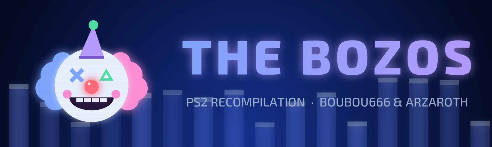

  

# hey, we're the bozos 🤡

We take games and turn them into actual PC programs. No emulator and no compromise.
The game's own code gets statically recompiled to C++,
then we chip away at every bit of PS2 hardware it still leans on until it runs
natively. 

Every port builds from your own disc. We don't want ninjas to stomp at our doors.
Ninjas and clowns... would you imagine?

## the ports

| Game | Repo | Current state |
|---|---|---|
| Champions of Norrath | [ChampionsOfNorrath_Recomp](https://github.com/TheBozos/ChampionsOfNorrath_Recomp) | Bring-up |
| Dark Cloud | [DC_Recomp](https://github.com/TheBozos/DC_Recomp) | Bring-up |
| Fighting for One Piece | [FightingForOnePiece_Recomp](https://github.com/TheBozos/FightingForOnePiece_Recomp) | Playable |
| Jade Cocoon 2 | [JC2_Recomp](https://github.com/TheBozos/JC2_Recomp) | Bring-up |
| The Lord of the Rings: The Third Age | [TLOTR_TTA_Recomp](https://github.com/TheBozos/TLOTR_TTA_Recomp) | Playable to the first battle |
| Smash Court Tennis Pro Tournament 2 | [SmashCourtTennisProTournament2_Recomp](https://github.com/TheBozos/SmashCourtTennisProTournament2_Recomp) | Playable |
| Soulcalibur III | [SoulCaliburIII_Recomp](https://github.com/TheBozos/SoulCaliburIII_Recomp) | Playable, in testing |
| Twisted Metal: Black | [TMB_Recomp](https://github.com/TheBozos/TMB_Recomp) | Playable, full speed, native ([0.4.0](https://github.com/TheBozos/TMB_Recomp/releases/latest)) |
| Valkyrie Profile 2: Silmeria | [VP2S_Recomp](https://github.com/TheBozos/VP2S_Recomp) | Playable (chapter 1) |

Screenshots, status and downloads for all of them: **[RecompWatcher](https://thebozos.github.io/RecompWatcher/)**.

## the engine

Twisted Metal: Black, Dark Cloud and Champions of Norrath are built on
[BozoEngine](https://github.com/TheBozos/BozoEngine), our own static recompiler and runtime.
No PS2 hardware at any level: what the game draws goes to a native renderer, and what it plays
goes to a native mixer.

The others are still on our fork of [PS2Recomp](https://github.com/TheBozos/PS2Recomp).
We've bolted a native renderer, a sound mixer and a pile of
other stuff onto it, and keep ripping out the emulation one piece at a time,
until BozoEngine replaces it for every game.

## who

[boubou666](https://github.com/boubou666) and [Arzaroth](https://github.com/Arzaroth), plus a lot of very busy
Claudes. All coordinated via [a very advanced communication protocol](https://github.com/Arzaroth/c2c-conv).
